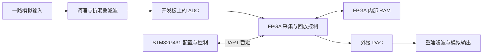

# 系统架构

本文件记录项目上下文及软硬件边界；软件目录与集成证据见 [软件架构](SOFTWARE_ARCHITECTURE.md)。来源与方案优先级见 [项目基线](PROJECT_BASELINE.md)。

## 检查范围与现状

已读取启动包内清单、说明及硬件更新，根目录提案 DOCX / PDF 文本、drawio 标签，并检查实际文件元数据。未执行原始安装器或项目脚本；未检查外部旧机器人项目、实物电路或板卡。

初始化后工作树包括 `docs/`、`stm32/`、`fpga/{rtl,sim,quartus}/`、`hardware/`、`tests/`。软件与 FPGA 路径目前为说明或占位文件，没有实际可运行系统。根目录原始五个输入文件保留本地且不公开。

## 材料描述的系统目标

下图是 v0.4 **拟建系统**，不是已实现或已验证的数据通路。

| 子系统 | 材料中提出的职责 | 外部边界 | 状态与依据 |
|---|---|---|---|
| STM32 | 配置与控制、命令与状态交互 | 硬件 UART，实际引脚、电平、波特率与协议待定 | 暂定；`docs/hardware-update.md`、`stm32/README.md` |
| FPGA 与存储 | ADC 时序、采集、地址 / 长度控制、RAM 访问和 DAC 回放 | 开发板时钟、转换器数字接口 | 仅规划；`fpga/` 为占位目录 |
| 模拟信号链 | 输入调理、抗混叠和输出重建滤波 | 转换器参考、电压范围、带宽与负载 | 待设计；`docs/hardware-update.md` |
| 电源 | 为外部模拟电路等提供经核对的电源轨，并测量性能 | 板卡规定输入、实际负载、电源地与回流 | 复用提议；最终分配与性能待确认 |
| 验证 | 独立接口验证、存储读写、真实模拟录放及电源测量 | 仪器与原始测量记录 | 未执行；`tests/README.md` |

转换器数据由 FPGA 处理，STM32 不承担连续样本流，这是启动材料中的职责划分。录制结束后，存储内容应独立于当前输入供 DAC 回放；此项为验证目标，尚无运行证据。

## 物理接口与边界

- ADC 候选为 DE1-SoC 板载 LTC2308，不能描述为 FPGA 芯片内置 ADC。
- DAC 优先借用，备选 Pmod DA2 / DAC121S101；实际接口时序和参考缩放未确认。
- FPGA 与 STM32 开发板使用其规定的供电输入；既有电源输出是否、如何用于模拟部分仍待验证。
- 原始框图中的未定选项与 v0.4 方案有差异，不可直接作为接线图。原理图、引脚分配、电平兼容和时序约束均尚缺。

## 推荐的后续架构工作

以下是建议，未在初始化中实施：

1. 核对实际硬件与课程范围，固定跨板接口、供电及转换器边界。
2. 沿用启动包的职责目录：`stm32/` 放独立 EFES 固件，`fpga/rtl/` 放 HDL，`fpga/sim/` 放测试台，`fpga/quartus/` 放工程与约束，`hardware/` 放新接线与电路资料。
3. 先定义命令 / 状态接口与存储行为，再实施并验证各模块；依赖方向为 STM32 控制命令 → FPGA 控制逻辑 → 存储与转换器，不绕过已定义接口。

本次没有目录迁移或源码变更。共享框架未指定，兼容性 `Not assessed`。未决项：借用与课程认可、接口定义、实际供电、仪器条件及构建配置。
