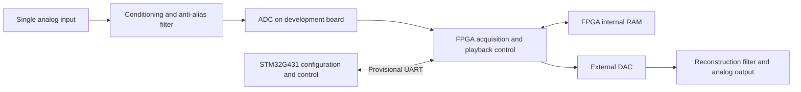

# System architecture

This document records the system context and hardware/software boundaries. Software structure and integration evidence are in the [software architecture](SOFTWARE_ARCHITECTURE.md). Source authority and proposal precedence are recorded in the [project baseline](PROJECT_BASELINE.md).

## Inspected scope and current state

The inspection covered the starter manifest, notes, and hardware update; text from the original root-level proposal DOCX / PDF; drawio labels; and actual file metadata. The original installer and project scripts were not executed. The external earlier robot project, physical circuits, and boards were not inspected.

The initialized working tree contains `docs/`, `stm32/`, `fpga/{rtl,sim,quartus}/`, `hardware/`, and `tests/`. Software and FPGA locations currently contain notes or placeholders, with no operational system. The five original root-level input files remain local and unpublished.

## System proposed by the supplied material

The following is the **proposed v0.4 system**, not an implemented or verified signal path.

| Subsystem | Proposed responsibility | External boundary | Status and evidence |
|---|---|---|---|
| STM32 | Configuration, control, commands, and status exchange | Hardware UART; actual pins, levels, baud rate, and protocol remain undefined | Provisional; `docs/hardware-update.md`, `stm32/README.md` |
| FPGA and storage | ADC timing, acquisition, address / length control, RAM access, and DAC playback | Development-board clock and converter digital interfaces | Planning only; `fpga/` contains placeholders |
| Analog signal path | Input conditioning, anti-alias filtering, and output reconstruction filtering | Converter references, voltage ranges, bandwidth, and load | Design pending; `docs/hardware-update.md` |
| Power | Supply verified rails to external analog circuits and other agreed loads, and measure performance | Specified board inputs, actual loads, grounds, and return paths | Reuse proposed; final allocation and performance need confirmation |
| Verification | Independent interface checks, storage read/write checks, actual analog recording/playback, and power measurements | Instruments and raw measurement records | Not run; `tests/README.md` |

The starter assigns converter data handling to the FPGA; the STM32 does not carry the continuous sample stream. After recording ends, stored contents should remain available for DAC playback independently of the current input. This is a verification target with no runtime evidence yet.

## Physical interfaces and boundaries

- The candidate ADC is the LTC2308 on the DE1-SoC board, not an ADC inside the FPGA device.
- Prefer a loaned DAC; the backup is Pmod DA2 / DAC121S101. Actual interface timing and reference scaling remain unconfirmed.
- FPGA and STM32 development boards use their specified supply inputs. Whether and how the existing power outputs serve the analog section remains to be verified.
- Open options in the original block diagram differ from v0.4. It is not a verified wiring diagram. Schematics, pin assignments, voltage compatibility, and timing constraints are still missing.

## Recommended architecture work

The following are proposals and were not implemented during initialization:

1. Confirm actual hardware and course scope, then define inter-board interfaces, power boundaries, and converter boundaries.
2. Keep the starter's responsibility-based locations: independent EFES firmware in `stm32/`, HDL in `fpga/rtl/`, testbenches in `fpga/sim/`, projects and constraints in `fpga/quartus/`, and new wiring/circuit records in `hardware/`.
3. Define command/status interfaces and memory behavior before implementing and verifying modules. The proposed dependency direction is STM32 commands -> FPGA control -> storage and converters; use the defined interfaces.

Initialization did not migrate directories or modify source code. No shared architecture profile has been designated; compatibility is `Not assessed`. Open items include loans and course acceptance, interface definitions, actual supplies, instruments, and build configurations.
